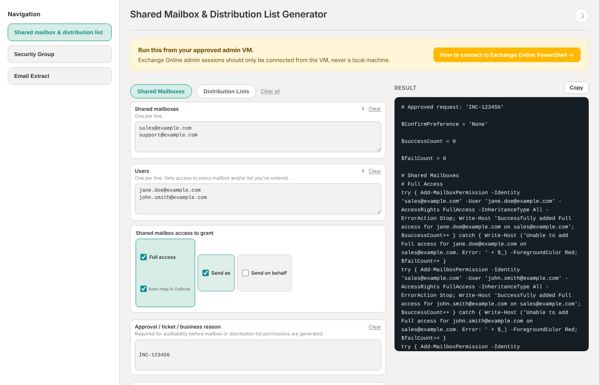

# IT Admin Portal

A single-page browser tool that generates ready-to-run PowerShell for common Exchange Online and Active Directory access requests. Paste in mailboxes, lists, groups, and users, choose the access, and copy out a script with error handling and a success/failure summary.

**Live demo:** https://sshower111.github.io/it-admin-portal/

## Why

Granting mailbox and group access one user at a time in the admin centers is slow and error-prone. This tool turns a ticket's list of users into one script, which saves about 3 minutes per user on bulk requests.

## Features

**Shared mailboxes and distribution lists (Exchange Online)**
- Full Access (with optional Outlook auto-mapping), Send As, and Send on Behalf
- Distribution list membership, Send As, and Send on Behalf
- Add or remove mode
- Each change wrapped in `try/catch`, with a final success/failure count

**Security groups (Active Directory)**
- Add or remove users by email address
- Looks up the group once and skips users who are already in the group (or already not in it)
- Reports users or groups that can't be found

**Email extractor**
- Pulls clean, de-duplicated email addresses out of pasted text such as `Jane Doe <jane.doe@example.com>`

## Safeguards

- **A ticket or approval reference is required** before a script is generated, and it's written into the script header for auditing.
- **Protection against script injection.** Values are single-quoted and escaped, and input containing `"`, `` ` `` or `$` is rejected.
- **The tool never connects to anything.** It only generates text. You review the script and run it yourself in an authenticated session.

## Usage

1. Open `index.html` in any browser (no install or build step), or use the live demo.
2. Connect to [Exchange Online PowerShell](https://learn.microsoft.com/en-us/powershell/exchange/connect-to-exchange-online-powershell), or use a machine with the ActiveDirectory module for group changes.
3. Fill in the form, click **Generate PowerShell**, review the output, then copy and run it.

## Tech

Vanilla HTML, CSS, and JavaScript in a single file, with no dependencies. Generated scripts use the `ExchangeOnlineManagement` and `ActiveDirectory` PowerShell modules.

> All names and addresses in this repo are placeholders (`example.com`).
